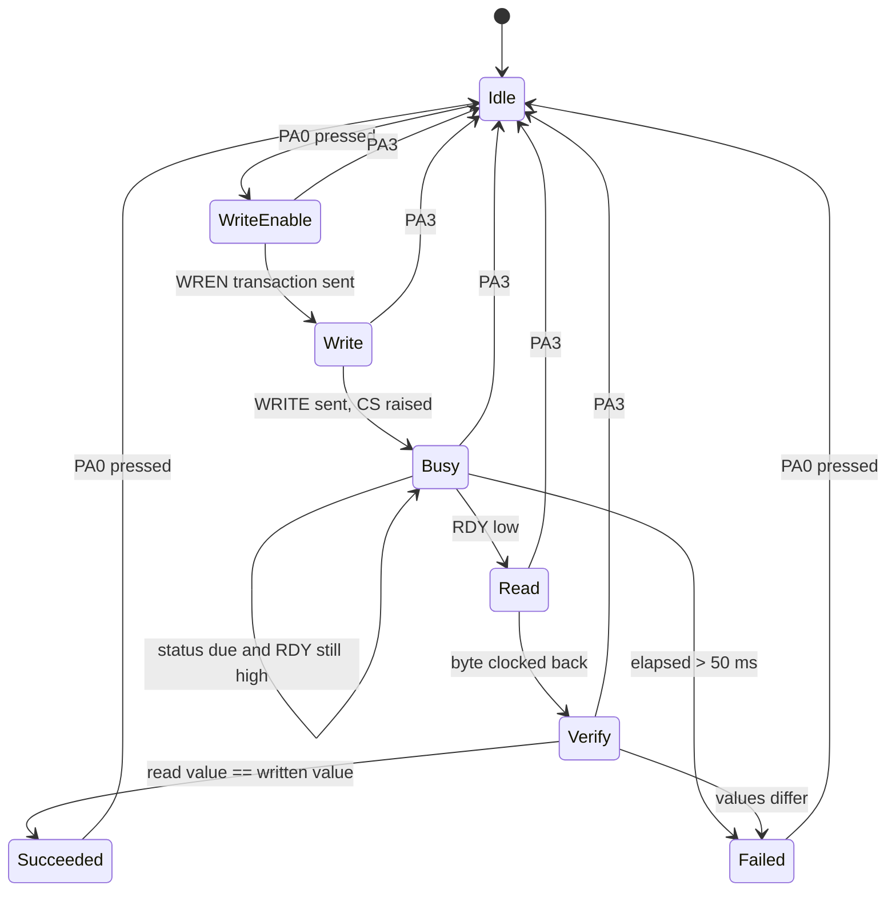

# Task 6 state machine

The Task 4 path blocks twice: once inside each SPI transaction, and once in the
loop that waits out the EEPROM's internal write cycle. The first is bounded by
the SPI clock and is a few tens of microseconds at 250 kHz. The second is up to
5 ms, which is the one that has to go.

So the design splits the transaction at every point where the board would
otherwise be waiting on the EEPROM rather than on itself.

## States

## Why these and not fewer

`WriteEnable` and `Write` are separate because the write enable latch is set on
the rising edge of CS after the WREN opcode. They cannot share a transaction,
so they cannot share a state.

`Busy` is the whole point of the task. It does not wait. On entry it records
the start time and the time the next status read is due; on each call it
returns immediately unless a poll is due, and when one is it performs a single
`eeprom_read_status()` and decides. Polling every 1 ms against a 5 ms typical
write costs about five status transactions.

`Verify` is separate from `Read` so that the comparison is a state transition
rather than something buried in the read step. It makes the success and failure
paths visible on the diagram, which is what the handout asks for.

## Abort

PA3 returns to `Idle` from any active state. The SPI bus is left usable: every
transaction raises CS before the state advances, so there is never a point in
this machine where an abort can strand CS low.

An abort during `Busy` does not stop the EEPROM. The device finishes its
internal write cycle regardless, because that cycle began when CS rose. Abort
abandons *our* transaction, not the device's, which is why the next run starts
with a status read that will find the part ready.

## Timing

| Constant | Value | Why |
|---|---|---|
| Poll interval | 1 ms | Five or so polls across a typical 5 ms write |
| Timeout | `EEPROM_WRITE_TIMEOUT_MS`, 50 ms | Ten times the datasheet maximum tWC of 5 ms |

The timeout decides nothing about success. It only catches a device that never
reports ready, which would otherwise hang the state machine in `Busy` forever.
Completion always comes from the RDY bit.
